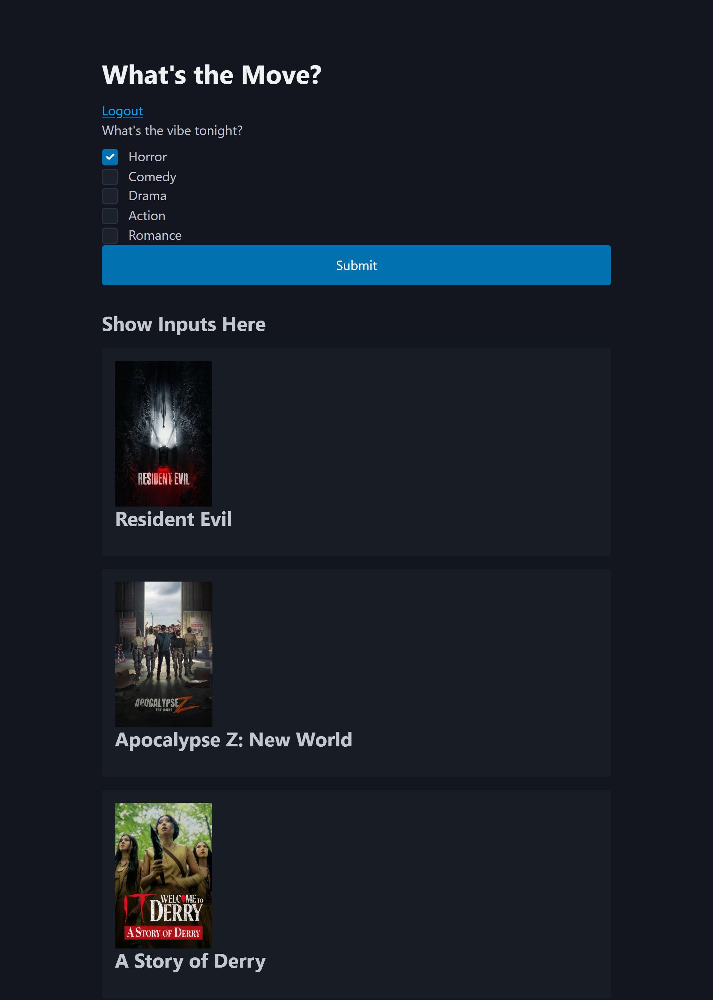

# What's the Move? App

## Project Description

What's the Move is a Fullstack CRUD app that allows users to select what genre of movie they are into for a movie night with friends. The app delievers movies that fit one or more genres and builds a watch list.

Future Feature: Join your friend group and add movies to a group watchlist to decide on a movie together. 

### How It's Made:

**HTML & CSS – Structure and styling**
**JavaScript – Front-end and back-end functionality**
**Node.js – Server-side JavaScript**
**Express.js – Routes and handling requests**
**MongoDB – Storing user accounts and saved pins**
**EJS – Displaying dynamic content**
**Passport.js – User authentication**

## Installation

1. Clone repo
2. run `npm install`

## Usage

1. run `npm run dev`
2. Navigate to `localhost:8080`

## Screenshots and Demo

### Application Interface

